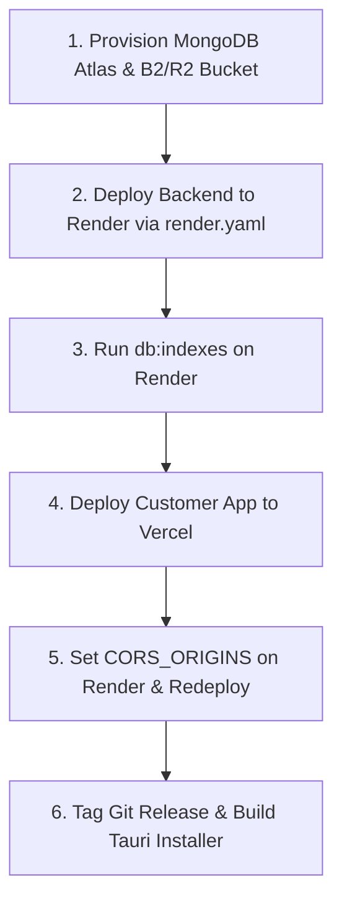

# PrintHub Production Deployment Guide

This guide details the complete production deployment architecture, step-by-step rollout order, cloud resource provisioning, smoke test procedures, and remaining manual action items for PrintHub.

---

## 1. System Architecture & Targets

PrintHub is a **pnpm monorepo** consisting of four primary packages/applications:

| Component | Target Platform | Technology Stack | Production URL / Distribution | Notes |
| :--- | :--- | :--- | :--- | :--- |
| **`backend`** | Render Web Service | Express, Socket.IO, Mongoose, Pino | `https://api.yourdomain.com` | Always-on paid Starter plan (WebSockets requirement). Binds to `0.0.0.0:$PORT` with reverse proxy trust (`trust proxy: 1`). |
| **`customer`** | Vercel | Next.js 14 (App Router) | `https://print.yourdomain.com` | Monorepo root directory build with direct REST/WebSocket calls to `NEXT_PUBLIC_API_URL`. Direct S3 presigned PUT uploads. |
| **`business`** | Windows Desktop Installer | Tauri v2 (Rust) + Next.js static export (`out/`) | Windows NSIS Installer via GitHub Releases | Shopkeeper desktop agent with system tray persistence, local printer spooler integration, 20s WebSocket heartbeats, and autostart. |
| **`packages/shared`**| Internal Workspace Package | TypeScript, Zod, tsup | Monorepo internal dependency | Authoritative catalog, pricing calculations, schemas, and event types shared across client and server. |
| **Database** | MongoDB Atlas | MongoDB 7.0+ Replica Set | Atlas Connection String | Dedicated database user, connection pooling, and optimized indexes (`code`, `status + expiresAt`, `businessId + date`, TTL indexes). |
| **Object Storage**| Backblaze B2 / Cloudflare R2 | S3-Compatible API | Private Bucket | Presigned PUT/GET URLs with zero server bandwidth relay. 2-hour TTL auto-lifecycle and strict purge on job completion. |

---

## 2. Completed Production Readiness Checklist

All code changes across Phases 0–7 have been implemented, tested, and committed to git:

- [x] **Phase 0: Secrets & Environment Validation** (`f90844e`)
  - Removed all hardcoded credentials and default fallbacks from `backend/src/config/index.ts`.
  - Added strict Zod validation enforcing production rules: mandatory MongoDB URI, min 32-character JWT secrets, and rejection of `STORAGE_DRIVER=local`.
  - Configured comprehensive `.env.example` templates for `backend/`, `customer/`, and `business/`.
  - Verified `.gitignore` covers `.env`, `.env.*` (excluding `.env.example`), `tsbuildinfo`, `dist/`, `.next/`, `out/`, `business/src-tauri/target/`, and `node_modules`.

- [x] **Phase 1: Elimination of Hardcoded Localhost URLs** (`6687b07`)
  - Removed dev `/api` proxy rewrite from `customer/next.config.mjs` and enforced `NEXT_PUBLIC_API_URL` during production builds.
  - Configured REST (`https://`) and WebSocket (`wss://`) URLs dynamically across `customer/` and `business/`.
  - Replaced hardcoded counter poster QR URLs with `NEXT_PUBLIC_CUSTOMER_URL`.
  - Secured `local-storage.ts` with strict path traversal boundary checks.

- [x] **Phase 2: Backend Production Readiness & Launch Blockers** (`6895e55`, `042e555`)
  - Server binds `0.0.0.0` and listens to `process.env.PORT`.
  - Configured `app.set('trust proxy', 1)` for Render reverse proxy client IP detection.
  - Enforced strict production CORS allowlist in Express and Socket.IO.
  - Implemented `/healthz` (liveness) and `/readyz` (readiness verifying MongoDB + Storage reachability).
  - Graceful shutdown handlers for `SIGTERM` and `SIGINT` (closing HTTP, Socket.IO, and Mongoose cleanly).
  - Automated production index sync script (`backend/src/scripts/create-indexes.ts` executable via `pnpm --filter @printhub/backend db:indexes`).
  - Redacted Pino production logger (filtering `authorization`, `x-session-token`, passwords, and PII).
  - **Launch Blocker 1 (`purgeJob`)**: Storage object deletion includes exponential backoff retry and `headObject` deletion confirmation. MongoDB storage keys are only cleared once all object deletions succeed.
  - **Launch Blocker 2 (`submitJob`)**: Storage keys are validated against the session prefix (`jobs/${sessionId}/`), and page counts are strictly verified against server-confirmed records from `/uploads/confirm` stored in `UploadConfirmationModel`.
  - **Launch Blocker 3 (`recordDailyStats`)**: Revenue and print metrics (`docs`, `pages`, `sheets`, `bwSheets`, `colorSheets`) are recorded **only** for `PRINTED` jobs. `REJECTED` and `EXPIRED` jobs only update count metrics.
  - **Launch Blocker 4 (Sweeper)**: Background purge sweeper scans all non-terminal jobs past TTL and transitions them via `jobService.transitionStatus(...)`, ensuring socket events and metrics are emitted.
  - **Launch Blocker 5 (Business Agent Registration)**: Wired `registerAgent` in `business/src/app/layout.tsx` with persistent device ID generation, system printer discovery, and 20s heartbeat.

- [x] **Phase 3: Monorepo Build Optimization** (`8d01b07`)
  - Defined `"packageManager": "pnpm@9.15.4"` and `"engines": { "node": ">=20" }` in root `package.json`.
  - Added monorepo build, test, and typecheck scripts.
  - Verified clean frozen lockfile installation and workspace resolutions.

- [x] **Phase 4: Render Blueprint Specification** (`c536a7f`)
  - Created root `render.yaml` declaring starter web service with `/healthz` health check and dashboard-managed environment variables.

- [x] **Phase 5: Customer Vercel Setup** (`95976ed`)
  - Replaced external Google Fonts `@import` with `next/font/google` (`Plus_Jakarta_Sans` and `JetBrains_Mono`).
  - Added strict security headers (CSP, `X-Content-Type-Options: nosniff`, `Referrer-Policy: strict-origin-when-cross-origin`, `Permissions-Policy: camera=(self)`, `X-Frame-Options: DENY`).
  - Configured CSP `connect-src` allowing API HTTPS, WebSocket (`wss://`), and S3 bucket endpoints.
  - Confirmed no server-only or Node-only packages leak into customer bundle.

- [x] **Phase 6: Tauri Business Desktop Installer** (`bbd0b01`)
  - Generated all required multi-platform icons in `business/src-tauri/icons/`.
  - Configured `tauri.conf.json` with bundle target `["nsis"]`, `installMode: "currentUser"`, and strict CSP.
  - Added `tauri-plugin-autostart` and `tauri-plugin-single-instance` plugins and capability files (`capabilities/default.json`).
  - Created `.github/workflows/release-desktop.yml` to automatically build and release the Windows NSIS installer on `v*` git tags.

- [x] **Phase 7: Continuous Integration** (`fba7be3`)
  - Created `.github/workflows/ci.yml` with pnpm caching, running frozen install, shared package build, full typecheck, vitest tests, and Next.js/backend production builds.

---

## 3. Localhost & HTTP Hit Audit

The entire codebase was audited for occurrences of `localhost`, `127.0.0.1`, and `http://`. Below is the complete report and rationale for every remaining occurrence:

| File & Line | Content | Rationale |
| :--- | :--- | :--- |
| `backend/.env.example:11` | `CORS_ORIGINS=...,http://tauri.localhost` | Documents allowed origins in example template. `http://tauri.localhost` is the Windows WebView2 origin. |
| `backend/src/app.ts:40-43` | `origin.startsWith('http://localhost:')` | **Dev-only conditional**: Active strictly when `NODE_ENV !== 'production'` to enable local testing. |
| `backend/src/config/index.ts:29` | `.default('http://localhost:3000,...')` | **Dev-only conditional fallback**: Used only when running locally without explicit `CORS_ORIGINS`. |
| `backend/src/config/index.ts:75-76` | `http://localhost:${parsedEnv.PORT}` | **Dev-only fallbacks**: Used for `publicApiUrl` and `customerAppUrl` in development when variables are omitted. |
| `backend/src/realtime/gateway.ts:19-22` | `origin.startsWith('http://localhost:')` | **Dev-only conditional**: Socket.IO development CORS bypass. Ignored in production. |
| `business/src-tauri/icons/.../ic_launcher.xml:2` | `xmlns:android="http://schemas.android.com/apk/res/android"` | Standard Android XML schema namespace specification. |
| `business/src-tauri/tauri.conf.json:8` | `"devUrl": "http://localhost:3001"` | **Dev-only configuration**: Local web dev server address used only during `pnpm tauri dev`. |
| `customer/src/app/layout.tsx:41` | `xmlns=%22http://www.w3.org/2000/svg%22` | Standard SVG XML namespace in data-URI favicon. |
| `docs/runbook.md:52` | `MONGODB_URI=mongodb://127.0.0.1:27017/printhub` | Documentation example for local self-hosted developer setups. |

### Tauri v2 Windows Origin Header Verification
- On Windows, Tauri v2 uses Microsoft Edge WebView2.
- The default protocol origin sent by WebView2 for local custom assets is **`http://tauri.localhost`**.
- This is explicitly allowlisted in `CORS_ORIGINS` on the backend (`backend/.env.example`) and in the non-production dev fallback, ensuring seamless communication between the desktop shopkeeper app and the Render API.

---

## 4. Cloud Resources Checklist (Manual Provisioning Steps)

Before launching the backend and customer web apps, configure the following external cloud resources:

### A. MongoDB Atlas
1. **Cluster**: Create or use an existing M0 Free or M10+ dedicated cluster in your target region (e.g., `AWS / ap-south-1` or `us-east-1`).
2. **Database User**:
   - Create a dedicated database user (e.g., `printhub_app`).
   - Grant **least privilege** roles: `readWrite` scoped strictly to the `printhub` database. Do not use admin or atlasAdmin roles.
3. **Network Access**:
   - For Render web services with dynamic outbound IPs, add `0.0.0.0/0` (Allow Access from Anywhere) with a strong (min 32-character) randomized user password.
4. **Automated Backups**:
   - Ensure automated daily snapshots and point-in-time recovery (PITR) are enabled under the cluster backup tab.
5. **Connection String**:
   - Copy the SRV connection URI: `mongodb+srv://<username>:<password>@cluster0.xxxxx.mongodb.net/printhub?retryWrites=true&w=majority&appName=printhub`.

### B. Object Storage Bucket (Backblaze B2 or Cloudflare R2)
1. **Private Bucket**:
   - Create a new private bucket named `printhub-temp-storage`.
2. **Application Keys (Least Privilege)**:
   - Generate an application key scoped **only** to `printhub-temp-storage`.
   - Permissions needed: `readWrite` (PutObject, GetObject, DeleteObject, HeadObject).
3. **CORS Configuration**:
   - Set CORS rules to allow the customer web application to perform direct browser PUT uploads:
   ```json
   [
     {
       "corsRuleName": "AllowVercelCustomerUploads",
       "allowedOrigins": ["https://print.yourdomain.com", "http://tauri.localhost"],
       "allowedOperations": ["s3_put", "s3_head", "s3_get"],
       "allowedHeaders": ["*"],
       "exposeHeaders": ["ETag", "Content-Length"],
       "maxAgeSeconds": 3600
     }
   ]
   ```
4. **Lifecycle Safety Net Rule**:
   - Set a lifecycle rule on `jobs/` prefix to automatically expire and delete all object versions after **1 day (24 hours)**. This serves as an automated fallback if any job fails to purge.
5. **Backblaze B2 Versioning Requirement**:
   - Backblaze B2 buckets retain hidden versions on standard DeleteObject unless explicitly deleted with `VersionId` or configured with a lifecycle rule that removes non-current versions immediately. Ensure the lifecycle rule deletes non-current versions after 1 day.

### C. Domain Names & SSL Certificates
- **Vercel**: Assign custom domain `https://print.yourdomain.com` (or root domain).
- **Render**: Assign custom domain `https://api.yourdomain.com`.
- *Recommendation*: Configure custom domains **before** printing shop counter QR code posters, as QR codes encode permanent URLs that cannot be modified once printed.

---

## 5. Deployment Order & Execution Workflow

Follow this precise sequence to deploy PrintHub:



### Step 1: Deploy Backend to Render
1. Connect your GitHub repository to Render.
2. In the Render Dashboard, select **New > Blueprint** and select `render.yaml`.
3. In the Render Dashboard for the `printhub-backend` service, fill in the environment variables marked `sync: false`:
   - `MONGODB_URI`: Your Atlas connection string.
   - `JWT_ACCESS_SECRET`: Generate a 64-char random hex string (`node -e "console.log(crypto.randomBytes(32).toString('hex'))"`).
   - `JWT_REFRESH_SECRET`: Generate another 64-char random string.
   - `JWT_SESSION_SECRET`: Generate another 64-char random string.
   - `PUBLIC_API_URL`: `https://api.yourdomain.com` (or `https://printhub-backend.onrender.com`).
   - `CUSTOMER_APP_URL`: `https://print.yourdomain.com`.
   - `CORS_ORIGINS`: `https://print.yourdomain.com,http://tauri.localhost`.
   - `STORAGE_DRIVER`: `s3`.
   - `S3_ENDPOINT`: S3 endpoint URL (e.g., `https://s3.us-east-005.backblazeb2.com`).
   - `S3_REGION`: Region (e.g., `us-east-005` or `auto`).
   - `S3_BUCKET`: Your bucket name.
   - `S3_ACCESS_KEY_ID`: Application Key ID.
   - `S3_SECRET_ACCESS_KEY`: Application Secret Key.
4. Deploy the service and note your live Render API URL (e.g., `https://printhub-backend.onrender.com`).
5. In Render Shell, create the database indexes:
   ```bash
   pnpm --filter @printhub/backend db:indexes
   ```

### Step 2: Deploy Customer App to Vercel
1. In Vercel, click **Add New Project** and import the `PrintHub` repository.
2. Configure project settings:
   - **Framework Preset**: Next.js
   - **Root Directory**: `customer`
   - **Include source files outside of the Root Directory**: **Enabled (Checked)**
   - **Install Command**: `cd .. && pnpm install --frozen-lockfile`
   - **Build Command**: `cd .. && pnpm --filter @printhub/shared build && pnpm --filter @printhub/customer build`
3. Add Environment Variables:
   - `NEXT_PUBLIC_API_URL`: Your live Render API URL (e.g., `https://printhub-backend.onrender.com` or `https://api.yourdomain.com`).
   - `NEXT_PUBLIC_S3_ENDPOINT`: Your bucket endpoint URL.
4. Click **Deploy**. Note your live Vercel customer URL (e.g., `https://printhub-customer.vercel.app` or `https://print.yourdomain.com`).

### Step 3: Update Render CORS Allowlist
1. Return to the Render Dashboard > `printhub-backend` > **Environment**.
2. Update `CORS_ORIGINS` to include your live Vercel domain and custom domain:
   ```env
   CORS_ORIGINS=https://printhub-customer.vercel.app,https://print.yourdomain.com,http://tauri.localhost
   ```
3. Update `CUSTOMER_APP_URL` to your live Vercel domain:
   ```env
   CUSTOMER_APP_URL=https://print.yourdomain.com
   ```
4. Save changes and trigger a manual redeploy.

### Step 4: Build Windows Desktop Installer via GitHub Actions
1. In GitHub repository settings, go to **Settings > Secrets and variables > Actions**.
2. Add a repository secret:
   - Name: `NEXT_PUBLIC_API_URL`
   - Value: Your live Render API URL (`https://api.yourdomain.com` or `https://printhub-backend.onrender.com`).
3. Create and push a version tag:
   ```bash
   git tag v1.0.0
   git push origin v1.0.0
   ```
4. The `.github/workflows/release-desktop.yml` workflow will automatically run on `windows-latest`, compile the Rust binary, bundle the static Next.js export, and create a GitHub Release with the NSIS installer (`PrintHub Business_1.0.0_x64-setup.exe`).

---

## 6. End-to-End Production Smoke Test Checklist

Execute this smoke test procedure against your live deployed production environment:

1. **Health & Readiness Check**:
   - Access `GET https://api.yourdomain.com/healthz` -> Returns `200 OK` with `{ status: "ok" }`.
   - Access `GET https://api.yourdomain.com/readyz` -> Returns `200 OK` with `{ status: "ready", checks: { database: "healthy", storage: "healthy" } }`.

2. **CORS Enforcement Verification**:
   - Execute a preflight request from a disallowed origin:
     ```bash
     curl -i -X OPTIONS https://api.yourdomain.com/public/shop/demo \
       -H "Origin: https://malicious-origin.com" \
       -H "Access-Control-Request-Method: GET"
     ```
   - Confirm the request is rejected with `403 Forbidden` (`CORS request rejected: origin not allowed`).

3. **Desktop Agent Registration & Heartbeat**:
   - Download and run the NSIS installer on a Windows machine.
   - Sign up with a new shop account (e.g., "City Center Xerox").
   - Confirm the app registers the agent (`agent.deviceId` set in database), enumerates system printers, and transitions status to Open.
   - Check the Render logs to confirm WebSocket connection and periodic 20-second heartbeats.

4. **Counter Poster QR Verification**:
   - In the desktop app, navigate to `/poster`.
   - Verify the displayed QR code encodes the production customer URL (e.g., `https://print.yourdomain.com/p/<slug>`) with **no localhost references**.

5. **Customer Upload & Quote Verification**:
   - Scan the QR code or open the link on a mobile device.
   - Confirm shop status shows **Open**.
   - Upload a multi-page PDF document.
   - Verify magic byte inspection and server page-count calculation succeed.
   - Check that the live quote calculation matches the business pricing catalog.

6. **Real-Time Job Notification & Printing**:
   - Submit the print request (select UPI or Counter payment).
   - Verify the desktop agent receives the real-time `job.new` WebSocket event and displays a desktop toast within **2 seconds**.
   - Accept the job in the desktop app and mark it as `PRINTED`.
   - Verify the customer screen updates instantly to Completed.

7. **Zero-Trace Document Purge Verification**:
   - Within **30 seconds** of reaching `PRINTED`:
     - Inspect the storage bucket to confirm the file has been permanently deleted across all versions.
     - Inspect the MongoDB database document to confirm `storageKey` and `versionId` have been unset and `purgedAt` is recorded.
   - Check the business analytics dashboard to verify revenue and printed sheet counts are incremented correctly.

---

## 7. Windows Code Signing & Tauri Updater Roadmap

### Code Signing (SmartScreen Resolution)
- **Current Status**: Unsigned NSIS installers prompt a blue Windows Defender SmartScreen banner on first run ("Windows protected your PC"). Users must click *"More info"* and *"Run anyway"*.
- **Production Solution**:
  1. Acquire an **EV (Extended Validation)** or standard code-signing certificate (from DigiCert, Sectigo, or SSL.com) or use **Azure Trusted Signing**.
  2. Add certificate credentials to GitHub repository secrets (`SMARTSCREEN_CERT`, `SMARTSCREEN_PASSWORD`).
  3. Update `release-desktop.yml` to sign the executable and installer using `signtool.exe` prior to packaging.

### Tauri In-App Auto-Updater
- To enable automatic background updates:
  1. Generate Tauri updater signing keys: `pnpm tauri signer generate -w ~/.tauri/printhub.key`.
  2. Add the public key to `tauri.conf.json` under `plugins.updater.pubkey`.
  3. In `release-desktop.yml`, configure `tauri-action` to generate and upload `latest.json` release manifests.
  4. The desktop app will automatically detect new releases and prompt shopkeepers to update with a single click.
